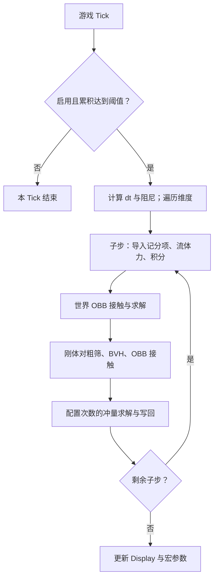

> 0.5 已删除旧NBT迁移函数及所有调用，实体元信息只需shape/state。

# 0.3 调度说明优先

updates_per_second 现在是结构数/Tick，旧 0.2 频率章节为历史说明，不用于当前配置。当前轮转流程、时间推进和主动/被动响应边界见 scheduler_0.3.md；记分板数值后端和宏边界仍按下文实现。

# Voxel Rigid 0.2 架构：记分板数值后端

## 变更与当前契约

0.2 将持续数值与计算寄存器改为记分板定点数。位置偏移、速度、四元数、角速度、质量、密度、矩阵和惯性采用倍率 **10000**；整数世界原点与体素数不缩放。实体 `data` 仅保存：

```snbt
{shape:"cube",state:"dynamic"}
```

Storage 只承担字符串元信息、宏参数、接触队列与显式调试桥接，数值提供器直接读取记分项。`src/scoreboard_schema.json` 是完整字段映射，旧后端说明保留在 `architecture_v01_reference.md`，其中旧状态与 API 不能直接用于当前版本。

| 属性 | 持久记分项 | 倍率 |
| --- | --- | --- |
| 世界整数原点 | vr.ox / vr.oy / vr.oz | 1 |
| 原点附近位置 | vr.px / vr.py / vr.pz | 10000 |
| 线速度 | vr.vx / vr.vy / vr.vz | 10000 |
| 世界角速度 | vr.wx / vr.wy / vr.wz | 10000 |
| 四元数 | vr.qx / vr.qy / vr.qz / vr.qw | 10000 |
| 总质量 / 逆质量 | vr.mass / vr.im | 10000 |
| 密度 / 包围半径 | vr.den / vr.rad | 10000 |
| 恢复 / 摩擦 | vr.e / vr.mu | 10000 |
| 旋转矩阵 | vr.r00 .. vr.r22 | 10000 |
| 局部逆惯性 | vr.j00 .. vr.j22 | 10000 |
| 世界逆惯性（工作值） | #a.K.r00 .. #a.K.r22，vr.num | 10000 |
| 局部惯性 | vr.i00 .. vr.i22 | 10000 |
| 体素数 | vr.count | 1 |

当前工作寄存器位于 objective=`vr.num`，如 `#a.v.x`、`#b.J.r00`、`#axis.x`；它们是共享假玩家寄存器，调用串行且不支持重入。不得在碰撞回调中再调用整个 tick，也不能把工作寄存器当作实体的持久状态。

## 更新频率、子步与迭代

```mcfunction
function vr:api/configure {updates_per_second:1,substeps:1,solver_iterations:4,step_ticks:1}
```

| 参数 | 范围 | 默认 | 作用 |
| --- | --- | --- | --- |
| updates_per_second | 1..20 | 20 | 每 20 个游戏 Tick 完成多少次物理更新 |
| substeps | 1..8 | 2 | 每次更新的积分/碰撞子步数 |
| solver_iterations | 1..16 | 4 | 每批接触的顺序冲量求解次数 |
| step_ticks | 1..20 | 1 | 每次完整更新推进多少模拟 Tick |

频率控制用 `#phase vr.cfg += #ups vr.cfg`；达到 20 时减去 20 并执行一次更新。1 Hz 每 20 Tick 更新一次，3 Hz 等不能整除 20 的频率会均匀分配到 6/7 Tick 间隔。不假设线程并行，不依赖每实体 schedule。

配置先验证临时值，全部合法后才提交；非法值返回 0 且保留原配置，成功返回 1。`/reload` 保留合法配置。`vr:api/pause` / `resume` 控制 `#enabled vr.cfg`。

**dt = step_ticks / substeps**。1 Hz、step_ticks=1 是慢速模拟，每游戏秒推进 1 模拟 Tick。若 1 Hz、step_ticks=20，则每游戏秒推进 20 模拟 Tick，但大 dt 会增加穿透与数值不稳定，离散碰撞和限速不保证 CCD。重力、力和四元数积分使用 dt；阻尼为 `0.998^(2dt)` 与 `0.995^(2dt)`，避免子步数改变时重复施加固定阻尼。

`vr:tick/dimension` 可显式驱动一次完整更新，忽略启用/频率门控，适合自定义维度与受控测试。全局 Tick 入口是 `vr:tick`。统计在一次被频率门控允许的更新开始时清零，因此低更新率时显示的是最近一次更新的统计。



## 数值提供器与闭环

读临时速度：

```json
{
  "type":"minecraft:mul",
  "inputs":[0.0001,{
    "type":"minecraft:from_int",
    "input":{
      "type":"minecraft:score",
      "score":"vr.num",
      "target":{"type":"minecraft:fixed","name":"#a.v.x"},
      "fallback":0
    }
  }]
}
```

实体导入不再拷贝整块数值 NBT：

```mcfunction
scoreboard players operation #a.v.x vr.num = @s vr.vx
```

计算结果先缩放、round，再存为记分项：

```mcfunction
execute store result score #a.v.x vr.num run compute default float {type:"minecraft:round",input:{type:"minecraft:mul",inputs:[10000.0,"vr:expression"]}}
scoreboard players operation @s vr.vx = #a.v.x vr.num
```

整数原点使用 integer provider。p 的整数部分每子步转移到 o，远处世界坐标不会乘 10000 后存进一个分数。两刚体原点差先进行整数运算，再转为 A 的局部坐标，所以碰撞力矩与点积仍在小数值区域计算。

宏前才把数值转换成参数 NBT：

```mcfunction
execute store result storage vr:work tp.x float 0.0001 run scoreboard players get #a.p.x vr.num
execute store result storage vr:work tp.ox int 1 run scoreboard players get #a.o.x vr.num
```

原点宏明确使用小数坐标，避免 X/Z 自动居中：

```mcfunction
$execute positioned $(ox).0 $(oy).0 $(oz).0 run tp @s ~$(x) ~$(y) ~$(z)
```

队列接触数据在 append 前显式导出，求解每个接触时导入寄存器；不为每次中间数学运算写 Storage。实体仍有两个字符串标记读取，类型派发继续使用：

```mcfunction
$return run function vr:state/$(state)
$function vr:shape/$(shape)/world
```

`execute as @e` 执行上下文依旧串行；使用统一入口方便多结构遍历，不会获得多线程计算。

## 逐结构质量

```mcfunction
execute as @e[type=minecraft:marker,tag=vr.root,sort=nearest,limit=1] run function vr:api/set_mass {mass:10.0}
```

默认总质量 `m=density×体素数`；范围 0.05..1000，引擎质量单位由项目自己定义。重量为 `m·g`，不是静止时恒定向下速度。所有密度相同的单位体素组成一个结构，设置总质量后，密度为 `m/count`。

保持几何、COM、线速度和角速度不变，设新质量 m'：

- `inv_mass = 1/m'`。
- `I' = I·m'/m`。
- `J' = J·m/m'`。
- 世界逆惯性 K 在下一次求解前由 `RJRᵀ` 重算。

因此平动冲量、旋转冲量与浮力加速度都随质量正确变化。不要直接只改 vr.mass；使用 set_mass / set_density API。静态结构不接受此 API，因为其逆质量与逆惯性已归零。连续多次改质量会有定点舍入误差。

## 精度


定点分辨率 1e-4。四元数归一化后写回也会量化；接触条件、短轴和除数保护已相应调整。测试容差随精度变化，不能拿旧浮点误差要求直接评价此后端。核心值有界，但低层 API 调用者仍须避免超出 32 位分数、非法四元数或零除。

## 物理与加速结构

物理算法与 0.1 相同：逐体素 15 轴 SAT，包围球粗筛，预生成二叉 BVH，完整惯性张量，法向与库仑摩擦冲量，按最多 32 个接触分摊位置修正，8 点体积采样浮力。每次检测存在分离轴即 return 0；BVH 节点不能相交时也短路。

BVH 沿最长轴中位数二分，节点球包含所有后代体素。查询为 A 的体素对 B 的 BVH；稀疏场景减少叶对，最坏仍是 V_A×V_B。世界单位体素只检查附近 27 个方块；任意地形占用不单调，不能直接二分格子。静态 section 缓存与双树遍历仍为后续方案。

固定姿态 sweep 先求所有 SAT 轴的共同进入/离开区间，再二分“[0,t] 内是否存在接触”的单调谓词，10 轮得 TOI 上界。默认 Tick 尚未接入旋转/平移 CCD。低层查询如今使用 `src/scoreboard_schema.json` 中的临时寄存器；旧版 Storage 输入示例须改为对应分数，不能直接沿用。

Display 每体素一个实体，更新公共质心与变换。低更新率时 Display 也按更新率刷新；当前 teleport/interpolation duration 为 1，不做跨整秒长插值。

## 性能边界与后续优化

score 后端减少了数值 NBT 路径访问，但增加实体记分项导入/写回；实际提升必须同场景测量。对象选择、每体素实体、SAT、队列与宏数据桥接仍有开销。低更新率可以直接减少每游戏秒总工作，但若同时提高 step_ticks，不会自动保证碰撞稳定。

优先考虑睡眠与改块唤醒、合并体素盒、静态接触缓存、接触面裁剪及 warm start。当前原版半砖/楼梯按完整格处理、流体采样有阶梯、复杂堆叠仍有限制。

数学库可直接桥接固定点记分项，但共享寄存器不能跨结构保留状态；adapters/lalib_matrix.mcfunction 为旧接口示例，接入本版时请把输出写入 #a.R.r00 等 vr.num 寄存器，并注意其 ivec/jvec/kvec 是矩阵列向量。项目不自动装载外部库。


## 0.2.1：不预设空间划分收益

结构间仍使用原版目标选择器，没有另建实体空间分区。新安装默认线性叶查询，BVH 为可选模式；两者使用相同叶包围球与 SAT。新增 stopwatch 可重复测量入口、交换次序对照和原版选择器计数入口。正式版 query 的返回值是秒数乘 scale 后截断；scale 不等于计时精度。细节、有效样本与预算中止样本见 profiling.md。


## 0.2.2：强制数值宏参数边界

本地宏调用前按其变量声明导出所需 score 值，保证 query/sample 等参数不依赖历史 Storage。修复了 0.2/0.2.1 的地形碰撞和浮力回归；见 fix_0.2.2.md。宏契约静态检查和缺失/污染参数回归测试已加入。
