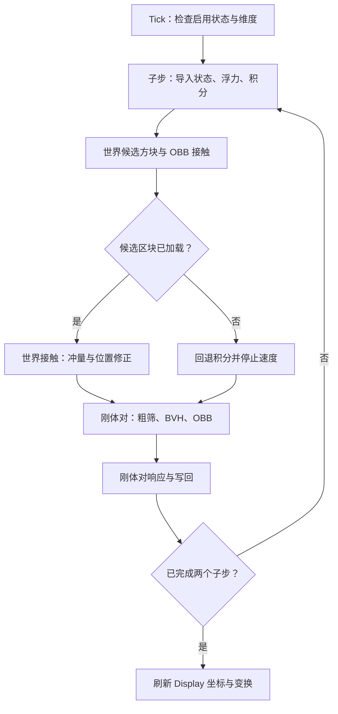

# 历史设计：0.1 Storage 后端，当前版本不要按本文件的状态/API 操作

# Voxel Rigid 0.1 架构与实现

## 1. 实现范围与版本依据

目标为 Minecraft Java Edition 26.3 正式版，数据包格式 **121.0**。使用单数 `function`、`tags/function` 与 `tags/block` 路径。Block State NBT 使用 `id` 与 `properties`。原版计算通过：

```mcfunction
data modify storage vr:work result set compute default float vr:expression
execute store result score #result vr.tmp run compute default float vr:expression 1000000
```

版本依据：<https://www.minecraft.net/en-us/article/minecraft-java-edition-26-3>。正式版支持独立的 context_int_provider / context_float_provider；float 为单精度。不要沿用 Snapshot 10 的旧 `/compute` 参数顺序，也不要把预发布的 119.0 当作正式版格式。

| 模块 | 本版本实现 | 近似或后续内容 |
| --- | --- | --- |
| 结构 | 编译时定义的单位体素集合，可凹形 | 未实现运行时世界方块抓取、结构胶或拆分 |
| 姿态 | 四元数、旋转矩阵、三维角速度 | 未加入陀螺项与自动睡眠 |
| 世界碰撞 | 逐体素 OBB 对世界单位立方体的 15 轴 SAT | 原版半砖、楼梯、栅栏等按完整方块处理 |
| 刚体互撞 | 包围球粗筛、预生成二叉 BVH、逐叶 OBB SAT | 无全局空间哈希；密集场景最坏仍为二次复杂度 |
| 响应 | 角冲量、四轮顺序求解、库仑摩擦、位置修正 | 支持特征中心近似接触点，无裁剪流形、warm start |
| 浮力 | 每体素 8 点体积积分、偏心浮力力矩、相对水流阻力 | 流动水高度近似，未自动采样局部水流矢量 |
| 连续检测 | 单对固定姿态 OBB 的扫掠与 10 轮二分 API | 未接入默认 tick；默认限速与两个离散子步 |
| 渲染 | 每体素一个 block_display，公共质心与局部变换 | 无客户端图形验收，需在游戏内观察插值 |

## 2. Tick 流程



时间以游戏 tick 为单位，子步 dt=0.5。默认重力 -0.04 block/tick²，两个子步合计一个 tick。速度软限幅为 0.45 block/tick；角速度按 `|ω|·radius <= 0.18 block/tick` 限制旋转边缘速度。此限幅减少离散漏检，但不是 CCD 的替代证明。

核心执行结构：

```mcfunction
execute as @e[type=minecraft:marker,tag=vr.root] at @s run function vr:body/integrate
execute as @e[type=minecraft:marker,tag=vr.root,tag=!vr.frozen] at @s run function vr:body/world
execute as @e[type=minecraft:marker,tag=vr.root,tag=!vr.frozen] at @s run function vr:pair/outer
```

**`execute as @e` 不是多线程。** 它分叉命令执行上下文，子函数仍串行运行。是否比手写单实体派发更快，取决于选择器成本、分叉数量和函数内容，需同场景基准测试。其在本架构中的价值是统一实体入口与减少手写循环，不是获得并行计算。

## 3. 状态维护与 NBT 隔离

每个刚体有一个 marker（tag=`vr.root`），其 `data` 为持久状态。Display 只存原版渲染 NBT，通过 `vr.id` 与 `vr.voxel` 记分项连接刚体和体素索引。引擎不依赖 Display 的 Motion。

典型状态（缩写矩阵字段，所有物理数值须使用 float NBT）：

```snbt
{
  shape:"ell", state:"dynamic",
  o:{x:1000000,y:80,z:-1000000},
  p:{x:0.5f,y:0.5f,z:0.5f},
  v:{x:0.1f,y:0.0f,z:0.0f},
  q:{x:0.0f,y:0.0f,z:0.0f,w:1.0f},
  w:{x:0.0f,y:0.02f,z:0.0f},
  R:{r00:1.0f,r01:0.0f,...},
  J:{r00:1.0f,r01:0.0f,...},
  inv_mass:0.2f, density:1.4f,
  radius:2.0f, count:4, e:0.1f, mu:0.55f
}
```

`o` 是整数世界原点，`p` 是附近浮点偏移。每次积分后用 floor 将 p 的整数部分转移到 o，避免把远处绝对坐标转换成低精度 float。相邻刚体 B 的原点差先用 context_int_provider 计算，再转换为 A 局部坐标系：

`bp = float(b.o - a.o) + b.p`。

因此坐标差、碰撞和力矩在局部小数值上计算。渲染和方块查询用宏重新建立绝对执行原点：

```mcfunction
$execute positioned $(ox).0 $(oy).0 $(oz).0 run tp @s ~$(x) ~$(y) ~$(z)
```

这里的 `.0` 很重要：纯整数绝对 X/Z 坐标会发生自动居中，导致半格偏移。

工作 Storage `vr:work` 的字段契约：

| 字段 | 生命周期与用途 |
| --- | --- |
| `a` / `b` | 本次世界碰撞或刚体对的状态副本 |
| `bp` | B 在 A 原点下的位置；静态世界代理为零 |
| `ac` / `bc` | 当前两个单位体素中心 |
| `axis`, `n`, `best` | SAT 临时量，轴函数不得覆盖 ac/bc |
| `contacts` / `queue` | 本刚体或刚体对的接触与求解队列 |
| `query`, `sample`, `draw`, `tp` | 独立宏参数帧 |
| `local`, `node`, `nc` | 编译形状与 BVH 临时量 |
| `force`, `torque`, `flow` | 本刚体的流体力积分 |

导入和写回示例：

```mcfunction
data modify storage vr:work a set from entity @s data
function vr:dispatch/state with storage vr:work a
data modify entity @s data set from storage vr:work a
function vr:body/teleport
```

Scratch 是串行共享的，**不支持重入**：不要在接触回调中再次调用整套 tick，也不要让库回调覆盖 `a` / `b`。一个实体调用完全结束后才允许下一实体导入。递归 BVH 的父节点在子调用返回后无需读取其临时字段，因此不需要额外节点栈。

Scoreboard 保存整数身份、索引、布尔条件和计数；不把所有运动状态往返转换为记分板。比较 float 时通过 `/compute` 倍率 1e6 变为整数，存在约 1e-6 的判定分辨率。正常核心值有界，调用低层 API 时调用者须避免 NaN、零四元数、负质量或超范围数值。

## 4. 宏派发契约

高频状态函数名和形状名只来自生成器及引擎常量。不得把任意玩家字符串直接当作函数路径。

`vr:dispatch/state`：

```mcfunction
$return run function vr:state/$(state)
```

`vr:dispatch/world`：

```mcfunction
$function vr:shape/$(shape)/world
```

形状入口包括 `world`、`fluid`、`pairs`、`render`、`bvh/0`；状态目前是 `dynamic` 与 `static`。新增状态时须提供其函数并定义质量、惯性、碰撞参与契约。

宏变量只使用直接字段名。不能假定 `$(o.x)` 会解引用嵌套 NBT；本实现显式把 `a.o.x` 复制成 `tp.ox`，再使用 `$(ox)`。渲染帧类似：

```snbt
{id:12,ox:100,oy:80,oz:100,px:0.5f,py:0.5f,pz:0.5f,
 tx:-0.5f,ty:-0.5f,tz:-0.5f,qx:0.0f,qy:0.0f,qz:0.0f,qw:1.0f}
```

`if function` 用于碰撞短路。`vr:collision/axis` 必须返回 1（该轴未分离）或 0（已分离），SAT 父函数：

```mcfunction
execute unless function vr:collision/axis run return 0
```

存在分离轴立即结束，不继续检查剩余轴。命令自身是否成功和函数是否明确返回 1 是不同的契约，不应混用。

## 5. 预生成、BVH 与二分法

### 动态体素：预生成二叉 BVH

生成器把形状中心点沿跨度最大的轴排序，在中位数处二分，递归生成静态函数树。每个节点存其后代体素的包围球：中心是节点局部 AABB 中心，半径包含所有后代中心距离与单位体素外接球半径 sqrt(3)/2。

查询时只旋转节点中心，包围球半径在刚体旋转后不变：

`nc = bp + b.R · node.center`。

如果 `|nc-ac|² > (node.radius + sqrt(3)/2)²` 则 return 0；叶子才执行 SAT。包围球仅用于保守裁剪，最终碰撞仍是旋转立方体。

示例节点结构与生成命令：

```snbt
{center:{x:0.0f,y:0.0f,z:0.0f},radius:2.0f,left:1,right:4}
```

```mcfunction
execute if score #bound vr.tmp matches 1.. run return 0
function vr:shape/ell/bvh/1
function vr:shape/ell/bvh/4
```

数据已经编入函数常量，运行时不线性扫描 NBT 列表。本版遍历 A 的体素并查询 B 的 BVH；典型稀疏查询可减少叶对数量，密集重叠时仍可能检查 V_A·V_B 个叶对。**树被二分构建，不代表每次碰撞必定 O(log V)。** 双树遍历、OBB 节点和合并体素盒是下一阶段优化。

### 静态世界：局部方块候选

旋转后的单位立方体各轴半宽最多 sqrt(3)/2，所以只需检查体素中心所在格及 ±1 格邻域，共 27 个格子。先用中心距离的轴向界排除，再检查是否 loaded / passable，最后 OBB SAT。世界查询针对当前方块状态，不缓存旧地形，因此挖掘、放置后下一次检测立即生效。

这种局部枚举是 O(27V)，无需扫描整个刚体外围大体积。但它不是“对任意地形二分”。任意格子的占用序列不单调，二分会漏检。

大型静态场景的建议架构是显式注册活动 section，构建空/实/混合的八叉树，或排序的占用 run：

```snbt
{section:[0,4,0],revision:7,runs:[{y:0,z:0,x0:0,x1:15},{y:1,z:0,x0:0,x1:3}]}
```

按 y/z 键二分查到行，再在该行的有序不相交 x 区间中二分，空间求交输出实际候选。未注册区域使用 27 格实时查询。缓存必须有变化通知、dirty 重建或定期重验；仅凭静态缓存无法可靠处理任意玩家放置、活塞或第三方数据包改变地形。**这一 section 缓存是后续设计，本版本未实现。**

### 连续平移：有单调谓词的二分 API

`vr:query/sweep` 输入已归一化的 A/B 旋转矩阵、当前 ac/bc 与相对平移 `sweep.delta`，固定两者姿态。在每个 SAT 轴上计算：

`-radius <= d + speed*t <= radius`。

求每轴的进入/离开区间并与 `[0,limit]` 求交；所有区间共同非空才返回 1。这个判定才是“在 [0,t] 内曾经相交”的单调谓词。不能直接二分“t 时刻是否相交”，因为刚体可能穿过障碍后再次分离。

先检测整段，再执行 10 轮：

```mcfunction
function vr:query/sweep_test
execute if score #sweep_hit vr.tmp matches 1 run data modify storage vr:work sweep.hi set from storage vr:work sweep.limit
execute if score #sweep_hit vr.tmp matches 0 run data modify storage vr:work sweep.lo set from storage vr:work sweep.limit
```

输出 `sweep.exact` 为区间算法的进入时刻，`sweep.toi` 为二分上界，误差不超过 1/1024 段（另加 float / 判定量化误差）。已有区间解析解时，直接用 exact 通常更便宜；二分 API 展示并实现可复用的前缀判定契约。默认 tick 未启用它，也不包含旋转 CCD。

调用示例（先暂停引擎并设置 a/b.R，低层 work 不能在 tick 中重入）：

```mcfunction
data modify storage vr:work ac set value {x:0.0f,y:0.0f,z:0.0f}
data modify storage vr:work bc set value {x:3.0f,y:0.0f,z:0.0f}
data modify storage vr:work sweep set value {delta:{x:6.0f,y:0.0f,z:0.0f}}
execute store result score #hit vr.tmp run function vr:query/sweep
data get storage vr:work sweep.toi
```

在两者为轴对齐单位立方体时，进入时刻约为 1/3。

## 6. 力学与碰撞响应

生成阶段计算等密度体素集合的质心与完整惯性张量，包含每个单位立方体自身惯性与平行轴项：

`I = Σ m_i [(|r_i|² + 1/6) E - r_i r_iᵀ]`。

生成器求逆得到局部 J。运行时逆惯性：

`K = R J Rᵀ`。

同一形状使用统一密度；修改 mass 或 inv_mass 时也须同步更新 J，否则角响应不一致。密度决定总质量，显示方块材质本身不决定物理质量。

半隐式积分：

`v <- (v + dt*(g + force*inv_mass))*0.998`

`w <- (w + dt*K*torque)*0.995`

`p <- p + dt*v`

`q <- normalize(q + dt/2 * (0,w) ⊗ q)`。

w 是世界坐标角速度，所以四元数在左侧相乘。未实现 `-ω×(Iω)` 的陀螺项；大角速度或严格角动量守恒需要改为角动量积分。

窄相碰撞用 A 的三个轴、B 的三个轴与九个叉积轴。叉积轴过短时跳过，否则归一化并记录最小正重叠。法线方向是 **B 指向 A**。每对体素使用一个近似接触点：取支持特征中心的中点；不等同于真实接触多边形裁剪，斜面、边角与堆叠稳定性有限。

接触点速度：

`u = v_A + ω_A×r_A - v_B - ω_B×r_B`。

法向冲量：

`j_n = -(1+e)*(u·n) / [inv_mA+inv_mB + n·((K_A(r_A×n))×r_A + (K_B(r_B×n))×r_B)]`。

仅在靠近时施加；低于 0.08 block/tick 的碰撞关闭恢复系数，以减少落地弹跳。线速度变化为 ±j*inv_mass，角速度变化为 ±K(r×j)。切向使用相同的有效质量形式，并限制 `|j_t| <= μ*j_n`；材料摩擦系数采用几何平均。

每个世界刚体或刚体对最多保存 32 个接触，溢出记入 `#overflow vr.stat`。执行四轮顺序求解，再按接触数分摊位置修正：修正比例 0.3，穿透截断 0.2，允许误差 0.001。没有累计冲量与 warm start，四轮迭代不能替代成熟接触求解器；明显沉入地面或复杂堆叠时，应优先改流形与位置求解，而非盲目增加迭代数。

## 7. 浮力与阻尼

每个体素取局部 ±0.25 的 8 个采样点，旋转到世界后检测水。每个湿点贡献 1/8 方块体积：

`F_b = rho_water * |g| * V_wet * +Y`，默认水密度 1。

每个湿点同时计算相对水流的点速度阻力：

`F_d = -0.02 * V_sample * (v + ω×r - flow)`。

力矩为 `r×(F_b+F_d)`，从而让不同浸水部分产生转动响应。密度小于水的 raft/cube 可上浮，密度大于水的 bar/ell 倾向下沉。

源水无上方水时按 8/9 高度判断；流动水、落水按完整格子近似。不会根据原版流体 level 邻接差自动生成流速，均匀流速来自 `vr:config water_velocity`。八点采样产生离散浮力阶梯，可能在水面附近振荡；更平滑的实现应裁剪每体素与水面，并计算真实浸入体积和浮心。非水液体没有浮力支持。

## 8. Display 更新闭环

每个体素中心是生成器算出的质心相对坐标 c。Display 方块模型从 [0,0,0] 开始，所以局部平移应为：

`translation = R*(c - [0.5,0.5,0.5])`。

实体位置是刚体质心；left_rotation=q，scale=[1,1,1]，right_rotation=identity。本版用字段形式 transformation，避免手写矩阵行列存储顺序误用。

宏批量选择同一 owner / voxel 的 Display，设置 teleport_duration=1、interpolation_duration=1、start_interpolation=0。物理每 tick 两个子步，网络渲染每 tick 一次。临时 `draw` 帧与碰撞 `query` 帧隔离。每个体素仍有独立实体与变换更新，通信量随体素数线性增加；后续可合并同材质共面盒或使用客户端渲染扩展。

## 9. 数学库对接

本次读取的 math3.2_lalib 源码入口包括：

- `math:quat/_touvw`：quat_x/y/z/w，objective=int，倍率 10000；输出 ivec/jvec/kvec。
- `math:quat/_mult`：左乘姿态，输出 rquat_x/y/z/w。
- `math:quat/_norm_np`：四元数归一化，其注释规定模长范围 [0.5,1.5]。
- `math:fvec/_cross_vec`：共享 vec/fvec 与 int 临时记分项。

仓库：<https://github.com/xiaodou8593/math3.2_lalib>、<https://github.com/xiaodou8593/math3.2>。读取时 lalib 的 pack.mcmeta 仍宣告 max_format [107,1]，虽然部分函数已改为新 compute 语法；不能仅改 pack 格式就保证整库兼容 26.3。

`adapters/lalib_matrix.mcfunction` 提供准确的输入输出桥接示例：

```mcfunction
execute store result score quat_x int run data get storage vr:work a.q.x 10000
# y/z/w 同理
function math:quat/_touvw
execute store result storage vr:work a.R.r00 float 0.0001 run scoreboard players get ivec_x int
execute store result storage vr:work a.R.r10 float 0.0001 run scoreboard players get ivec_y int
execute store result storage vr:work a.R.r20 float 0.0001 run scoreboard players get ivec_z int
```

i/j/k 是矩阵列向量。适配文件未安装入默认独立包，也未对整套库做集成运行测试。先安装兼容且初始化好的库，再把适配器放入项目并替换 `math/matrix` 入口；共享库寄存器不能保留跨刚体状态。

Bookshelf 文档：<https://docs.mcbookshelf.dev/zh-cn/latest/>。其中 Block / Hitbox / Raycast 等模块适合后续方块形状与光线查询桥接，但此版没有调用 Bookshelf 接口，也不承诺通用命令可自动读取原版任意碰撞形状。large_number 可用于需要更大范围或精度的计算；此版局部原点策略避免了主要的大坐标问题，因此没有引入它的运行开销。

## 10. 性能、预算与优化路线

令 N 为活跃刚体数，V 为体素数，C 为保留接触数，P 为附近通过粗筛的刚体对数：

- 世界候选 O(27NV)，湿点检测 O(8NV)。
- 身份对枚举最坏 O(N²)，包围球失败可立即跳过。
- BVH 查询取决于重叠节点；最坏 O(PV²)。
- SAT 最多 15 轴，分离轴短路能节省大量计算。
- 四轮求解 O(4C)，C 上限 32/批次。
- 显示更新与实体数 O(NV)。

这里的常数很大：一次轴检测包含多个原版表达式评估和 Storage 写入，不能只用“函数调用数量”估计成本。预生成函数避免运行时解析形状和线性 NBT 搜索，但不消除数学与 NBT 开销。当前工程优先提供可验证的物理基线，尚不能称为成熟高性能引擎。

使用 `/function vr:api/stats` 观察 SAT、BVH、world、contacts、overflow；这些计数是当次 tick 的各维度合计。它们不等于完整命令数量。结合 `/tick sprint`、`/debug start` / `/debug stop` 与服务器性能分析，分别测试空旷下落、落地、互撞、堆叠、水面，以及开启/关闭渲染的差异。不要用空闲场景数字推断密集堆叠承载量。

优化优先级：

1. 静态接触缓存、自动睡眠与外部改块唤醒，消除静止刚体重复检测。
2. 体素合并为大盒，减少世界查询、SAT 与 Display 数量；可凹形用多个盒组合。
3. 全局空间哈希或 sweep-and-prune，替换附近实体两两粗筛。
4. 双 BVH 与更紧的节点包围盒，避免 A 线性遍历 B 的松散球树。
5. 接触面裁剪、最多 4 点流形、累计冲量与 warm start，改善稳定性并减少重复接触。
6. 预注册静态 section 缓存，提供明确变化通知与未注册区域回退。
7. 将固定姿态 sweep 接入高速候选，旋转采用保守推进或自适应子步。
8. 原版 provider、lalib 与记分板专用热路径同场景对比，只替换实际更便宜的运算。

增加 max_command_chain_length 可能让未完成的工作执行，但不会降低服务器耗时。复杂场景触及预算时应减少每 tick 工作，不能把静默中途终止当作正常分帧调度。本版不主动修改任何 gamerule，也没有严格的全 tick 工作预算恢复机制。

本次两单位方块测试的 `/tick sprint 100` 样本为 23.23 ms/tick（包括服务器和已加载区块），详细边界见 validation.md。当前基线可用于验证架构与物理行为，但离“多复杂刚体的高性能引擎”仍有优化距离；尤其需要睡眠、合并体素和接触缓存。
